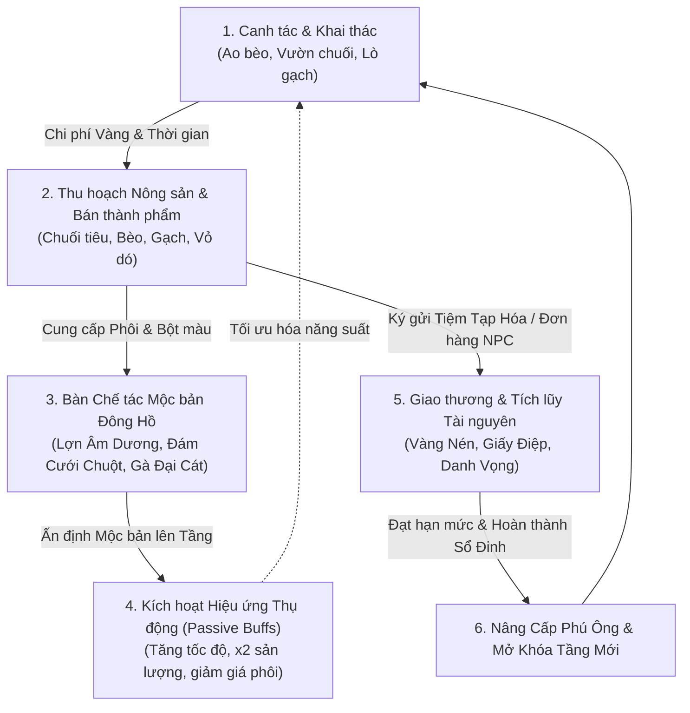

# 🌾 TÀI LIỆU YÊU CẦU SẢN PHẨM (PRD) - LÀNG TIỀN AN
**Tên dự án**: Làng Tiền An (Khu Vườn Mộc Bản Đông Hồ)  
**Thể loại**: Casual Vertical Farming / Crafting & Idle Simulation  
**Phong cách nghệ thuật**: Tranh dân gian Đông Hồ trên nền Giấy Điệp kết hợp Văn học hiện thực Việt Nam (Nam Cao)  
**Mục tiêu nền tảng**: Web HTML5, PWA (Progressive Web App) chạy trên Mobile Browser (tỷ lệ 9:16), Zalo Mini App, Telegram Mini App  
**Mô hình kinh tế**: 100% Free-to-Play, Không nạp tiền (Zero-IAP), Hỗ trợ tiến trình thông qua Quảng cáo nhận thưởng (Rewarded Ads) và Kỹ năng tính toán kinh tế  

---

## 1. TỔNG QUAN SẢN PHẨM & TẦM NHÌN

### 1.1. Tuyên ngôn Sản phẩm (Product Vision)
**Làng Tiền An** tái hiện không gian làng quê Bắc Bộ thế kỷ 20 thu nhỏ trong lòng bàn tay qua thiết kế màn hình dọc một chạm (One-tap Vertical Layout). Kế thừa cơ chế canh tác từng tầng gây nghiện kinh điển của *Khu Vườn Trên Mây (Sky Garden)*, Làng Tiền An thổi vào đó linh hồn tranh khắc gỗ mộc bản Đông Hồ, sắc màu giấy điệp xà cừ óng ánh và những mẩu chuyện trào phúng, nhân văn từ các nhân vật văn học hiện thực (Chí Phèo, Thị Nở, Bá Kiến, Phú Ông).

### 1.2. Trụ cột Thiết kế Cốt lõi (Design Pillars)
1. **Dễ tiếp cận & Cuốn hút (Accessible & Addictive)**: Thao tác 1 tay tối ưu ngón cái (One-thumb Ergonomic), không cần cài đặt (Instant Play), gieo trồng - chế tác - thu hoạch trực quan.
2. **Bản sắc Dân gian Đậm đà (Vietnamese Folk Immersion)**: Ngôn ngữ đồ họa mộc bản dao khắc, bảng màu tự nhiên (điệp trắng, son đỏ, chàm biếc, hòe vàng), nhạc sáo trúc lofi và mõ làng.
3. **Kinh tế Chiều sâu & Công bằng (Fair & Rewarding Progression)**: Không cơ chế Pay-to-Win. Tăng trưởng kinh tế dựa trên chuỗi giá trị: Nông nghiệp $\rightarrow$ Thủ công nghiệp $\rightarrow$ Nghệ thuật Mộc bản $\rightarrow$ Thương mại.
4. **Hạ tầng Chống gian lận Tuyệt đối (Server-Authoritative Anti-Cheat)**: Khắc phục triệt để lỗ hổng tua đồng hồ máy khách bằng kiến trúc kiểm chứng thời gian trên Supabase Cloud Database.

---

## 2. VÒNG LẶP CỐT LÕI (CORE GAMEPLAY LOOP)

Vòng lặp vận hành liên tục qua 5 mắt xích khép kín:



1. **Gieo trồng / Đốt lò / Nuôi cấy**: Người chơi dùng Vàng Nén mua giống hoặc nguyên liệu khởi động các ô canh tác phân tầng.
2. **Thu hoạch**: Đợi đồng hồ đếm ngược kết thúc (hoặc xem thước phim ngắn để kích hoạt "Nhiệt huyết"), người chơi chạm/vuốt để gặt hái thành phẩm.
3. **Chế tác Mộc Bản**: Đưa nông sản và phụ liệu vào Bàn Khắc Mộc Bản để chế tạo các bức tranh mộc bản truyền thống sở hữu chỉ số buff.
4. **Giao thương & Hoàn thành Đơn hàng**: Bán nông sản dư thừa tại Tiệm Tạp Hóa hoặc hoàn thành đơn thu mua của dân làng (Chí Phèo nung gạch, Thị Nở nấu cháo hành).
5. **Tiến trình Xã hội (Phú Ông)**: Điểm Danh Vọng tích lũy từ thu hoạch và thành tích giúp thăng cấp tước hiệu, mở thêm ô đất và mở các tầng canh tác cao hơn.

---

## 3. HỆ THỐNG TIỀN TỆ & TÀI NGUYÊN (ECONOMY SYSTEM)

| Loại Tài Nguyên | Biểu Tượng | Vai Trò & Chức Năng | Nguồn Kiếm Được | Điểm Tiêu Thụ |
| :--- | :---: | :--- | :--- | :--- |
| **Vàng Nén** *(Gold)* | 🪙 | Tiền tệ lưu thông phổ thông trong làng. | - Bán nông sản, gạch nung tại Tiệm Tạp Hóa.<br/>- Đơn hàng thương lái & thưởng Sổ Đinh. | - Mua hạt giống bèo, cá, chuối, ngô.<br/>- Mua than nung, củi, phôi gạch.<br/>- Chi phí mở khóa tầng đất mới. |
| **Giấy Điệp** *(Shell Paper)* | 📜 | Tiền tệ đặc quyền / Tài nguyên quý hiếm (Gem). | - Xưởng Làm Giấy Điệp (T4).<br/>- Thưởng hoàn thành Chương Thành Tích.<br/>- Xem video tiếp sức tự nguyện. | - Mua phôi gỗ quý chế tác Mộc Bản hiếm.<br/>- Bùa chú tăng tốc độ tức thì.<br/>- Mở rương bảo vật hội làng. |
| **Danh Vọng / Cấp Phú Ông** *(Fame / EXP)* | 👑 | Chỉ số uy tín và địa vị xã hội của người chơi. | - Nhận được từ mỗi lượt thu hoạch thành công.<br/>- Giao nộp lễ vật tại Đình Làng.<br/>- Đạt cột mốc trong Sổ Đinh. | - Mở khóa Tầng canh tác (T1 $\rightarrow$ T5).<br/>- Mở khóa công thức Mộc Bản cao cấp.<br/>- Nhận tước vị và quyền lợi làng xã. |

### Các Cấp Bậc Tiến Trình Xã Hội (Cấp Phú Ông)
1. **Bần Nông** (Cấp 1 - 2): Khởi đầu bên bờ ao bèo xơ xác, quản lý 4 ô nuôi bèo hoa dâu.
2. **Trung Nông** (Cấp 3 - 7): Tích lũy đủ vốn, khai hoang Vườn Chuối bãi bồi ven sông Đáy.
3. **Thợ Thủ Công** (Cấp 8 - 14): Thổi lại ngọn lửa Lò Gạch Cũ cùng Chí Phèo, tạo ra gạch Bát Tràng.
4. **Nghệ Nhân Làng** (Cấp 15 - 24): Khôi phục Xưởng Giấy Dó, thuần thục ngâm vỏ dó và tán bột sò điệp.
5. **Phú Ông Tri Huyện** (Cấp 25+): Vang danh bốn cõi, làm chủ Sân Đình Cổ Kính, điều hành lễ rước hội làng.

---

## 4. CHI TIẾT 3 TẦNG CANH TÁC CƠ SỞ (T1, T2, T3) & TIẾN TRÌNH TẦNG CAO

Thế giới game là một trục cuộn dọc dài `720 × 2200px`. Người chơi vuốt nhẹ màn hình để di chuyển mượt mà qua các tầng:

### 4.1. Tầng 1: Ao Bèo & Bến Nước (Y = 1750 – 2200)
- **Bối cảnh**: Mặt ao làng biếc xanh rợp bóng bèo dâu, bến nước rửa chân bằng đá ong, chiếc thuyền nan cắm sào chao nghiêng theo sóng nước.
- **Ô tương tác**: Gồm 4 cọc bè tre nổi trên mặt nước.
- **Sản phẩm canh tác**:
  - *Bèo Hoa Dâu*: Thời gian sinh trưởng 1 phút (60s). Vốn: 5 Vàng $\rightarrow$ Thu: 8 Vàng (+60% ROI), 2 Danh Vọng.
  - *Cá Chép Vàng*: Thời gian 15 phút (900s). Vốn: 50 Vàng $\rightarrow$ Thu: 110 Vàng (+120% ROI), 25 Danh Vọng.
  - *Ốc Mít Rãnh Nước*: Thời gian 45 phút (2700s). Vốn: 120 Vàng $\rightarrow$ Thu: 320 Vàng (+166% ROI), 60 Danh Vọng.

### 4.2. Tầng 2: Vườn Chuối Bãi Bồi (Y = 1300 – 1750)
- **Bối cảnh**: Vùng đất bãi bồi phù sa trù phú bên triền đê. Những rặng chuối trổ hoa tím ngát, lá rách tơi tả trong gió mùa, đan xen rẫy ngô trĩu bắp.
- **Ô tương tác**: Gồm 4 luống đất vun cao phủ rơm rạ mục.
- **Sản phẩm canh tác**:
  - *Chuối Ngự Nam Sang*: Thời gian 5 phút (300s). Vốn: 20 Vàng $\rightarrow$ Thu: 45 Vàng (+125% ROI), 10 Danh Vọng.
  - *Ngô Nếp Bãi Bồi*: Thời gian 30 phút (1800s). Vốn: 80 Vàng $\rightarrow$ Thu: 210 Vàng (+162% ROI), 45 Danh Vọng.

### 4.3. Tầng 3: Lò Gạch Cũ (Y = 850 – 1300)
- **Bối cảnh**: Lò gạch thủ công vách đất hình vòm nứt nẻ, khói than nghi ngút lan tỏa trong chiều tà. Bác Chí Phèo ngồi quạt lò bên đống củi khô và vò nước nguội gạch.
- **Ô tương tác**: Gồm 4 cửa lò nung đất nung đỏ.
- **Sản phẩm chế tác**:
  - *Gạch Nung Đất Sét*: Thời gian 20 phút (1200s). Vốn: 60 Vàng $\rightarrow$ Thu: 180 Vàng (+200% ROI), 35 Danh Vọng.
  - *Gạch Bát Tràng Men Tro*: Thời gian 2 giờ (7200s). Vốn: 250 Vàng $\rightarrow$ Thu: 850 Vàng (+240% ROI), 150 Danh Vọng.

### 4.4. Tầng Mở Rộng: Tầng 4 (Xưởng Giấy Dó) & Tầng 5 (Sân Đình)
- **Tầng 4 - Xưởng Giấy Dó (Y = 400 – 850)**: Chế tạo Giấy Dó Thô và Giấy Điệp Ánh Bạc (cho ra trực tiếp đơn vị Giấy Điệp).
- **Tầng 5 - Sân Đình Cổ Kính (Y = 0 – 400)**: Nơi dâng lễ vật hương án, cúng tế hội làng, nhận sắc phong từ Bá Kiến.

---

## 5. HỆ THỐNG NHÂN VẬT DÂN GIAN & TRÀO PHÚNG (NPCs)

Các nhân vật tương tác trực tiếp với người chơi qua bảng hội thoại truyện tranh mộc bản:

```
┌─────────────────────────────────────────────────────────────┐
│ 🏮 BÁC CHÍ PHÈO (Quản Đốc Lò Gạch Cũ)                      │
│ - Tạo hình: Áo nâu chàm phanh ngực, tay cầm quạt nan tre.    │
│ - Hành vi: Chăm sóc lửa lò gạch, phát động trạng thái        │
│   "Nhiệt Huyết" (Giảm 30% thời gian nung khi tiếp tế chuối). │
│ - Lời thoại: "Tao nung mẻ gạch này đỏ au hơn cả mặt trời!"  │
├─────────────────────────────────────────────────────────────┤
│ 🍲 CHỊ THỊ NỞ (Bếp Trưởng Quán Cháo Hành)                  │
│ - Tạo hình: Váy đụp đính hoa, nụ cười hào sảng hiền hậu.    │
│ - Hành vi: Thu mua chuối chín, bèo hoa dâu, ốc mít để nấu    │
│   cháo; trả Vàng Nén và ban thưởng điểm Danh Vọng cao.      │
│ - Lời thoại: "Ăn bát cháo hành này vào là cấy cày quên mệt!"│
├─────────────────────────────────────────────────────────────┤
│ 📜 PHÚ ÔNG BÁ KIẾN (Giám Sát Địa Bộ & Đình Làng)            │
│ - Tạo hình: Khăn đóng áo dài the đen, phe phẩy quạt lông cò.│
│ - Hành vi: Ra chỉ tiêu thu gom gạch nung, nông sản tiến vua;│
│   cấp "Chiếu Thư Khai Mở" khi người chơi đủ điều kiện thăng │
│   cấp tầng đất mới.                                         │
└─────────────────────────────────────────────────────────────┘
```

---

## 6. HỆ THỐNG BẢN KHẮC MỘC BẢN ĐÔNG HỒ (CRAFTING BUFF)

Thay thế hoàn toàn cơ chế "chậu cây trang bị" đơn điệu bằng nét văn hóa in tranh mộc bản truyền thống:
- Người chơi thu thập **Gỗ Thị** và **Bột Màu Tự Nhiên** (chàm, son, hòe, than tre) để khắc các ván in dân gian.
- Khi hoàn thiện một bản khắc, người chơi có thể **Ấn Định Dấu Son** mộc bản lên một tầng cụ thể để kích hoạt hiệu ứng bổ trợ vĩnh viễn (hoặc theo chu kỳ):
  - **Mộc Bản Gà Đại Cát**: Ấn định tại Tầng 2 $\rightarrow$ Giảm 15% thời gian sinh trưởng của Chuối và Ngô.
  - **Mộc Bản Cá Chép Trông Trăng**: Ấn định tại Tầng 1 $\rightarrow$ Tăng 20% sản lượng vàng khi thu hoạch Cá Chép.
  - **Mộc Bản Lợn Âm Dương**: Ấn định toàn làng $\rightarrow$ Tăng 10% cơ hội rơi nguyên liệu quý khi gặt hái.
  - **Mộc Bản Đám Cưới Chuột**: Ấn định tại Tầng 3 $\rightarrow$ Giảm 20% chi phí than củi khi nung gạch.

---

## 7. CẤU TRÚC POPUP & MODAL GIAO DIỆN (UI/UX SPECIFICATIONS)

Dựa theo mẫu thiết kế chuẩn trong `public/assets/references/`:

### 7.1. HUD Scene (Giao diện Tổng thể Trong game)
- **Đầu trang (Top Bar)**: Bảng gỗ treo hiển thị 3 hộp ngọc:
  - Khung Vàng Nén: Icon đồng tiền khắc cổ + số dư.
  - Khung Giấy Điệp: Icon cuộn giấy ngà lấp lánh + số lượng.
  - Khung Phú Ông: Cấp sao danh vọng + thanh tiến trình kinh nghiệm màu ngọc bích.
- **Cuối trang (Bottom Dock)**: Thanh gỗ kê 4 nút mộc bản:
  1. *Bản Đồ (Hội Làng)*: Điều hướng nhanh tầng.
  2. *Tiệm Tạp Hóa*: Quầy thu mua & hợp đồng nông sản.
  3. *Khắc Gỗ*: Bàn chế tác ván in Đông Hồ.
  4. *Thành Tích*: Sổ đinh ghi công đức làng.

### 7.2. Popup: Chiếu Thư Khai Mở (Floor Progression Modal)
- **Hình thức**: Tấm sắc phong hoàng kim cuốn hai đầu rồng bằng ngọc, mép giấy xơ sợi dó tự nhiên.
- **Nội dung**: Tuyên cáo người chơi đã đạt đủ tiêu chuẩn thăng cấp (ví dụ: Đạt cấp Thợ Thủ Công + 3000 Vàng + 50 gạch nung). Nút bấm "Khai Hoang Lập Tầng" đóng dấu mộc triện đỏ son bốc khói rực rỡ.

### 7.3. Popup: Sổ Đinh Thành Tích (Achievement & Quest Log)
- **Hình thức**: Quyển sách chỉ may gáy cổ truyền của hương hào lý dịch, giấy ngà vàng ố góc thời gian.
- **Nội dung**: Danh sách nhiệm vụ theo chương (Ví dụ: "Thu hoạch 100 nải chuối Nam Sang", "Giữ lò gạch đỏ lửa 24 giờ"). Người chơi bấm "Lĩnh Thưởng" để nhận Giấy Điệp và Danh Vọng.

### 7.4. Popup: Bàn Chế Tác Mộc Bản (Woodcut Workshop Modal)
- **Hình thức**: Mặt bàn gỗ lim thô mộc, bên trên đặt dao khắc mác, ván gỗ thị nguyên khối, các lọ mực tự nhiên và nghiên mực son.
- **Nội dung**: Lưới chọn bản thảo tranh dân gian cần khắc, hiển thị tiến độ đục rãnh gỗ, tỉ lệ thành công và nút đóng triện đỏ khi tác phẩm hoàn mỹ.

### 7.5. Popup: Ngăn Kéo Tiệm Tạp Hóa (Trading Drawer)
- **Hình thức**: Tủ thuốc Bắc nhiều ô ngăn kéo gỗ kéo ra kéo vào sống động, có chuông gió đồng leng keng.
- **Nội dung**: Danh mục đơn vị hàng hóa cần ký gửi bán lấy Vàng hoặc thu mua hạt giống dự trữ cho vụ mùa tới.

---

## 8. TIÊU CHUẨN THÀNH CÔNG & CHỈ SỐ DOANH THU (KPIs)
- **D1 Retention (Tỉ lệ giữ chân ngày 1)**: $\ge 45\%$ nhờ cơ chế gieo bèo 1 phút và chuối 5 phút tạo nhịp độ cuốn hút ngay phiên chơi đầu.
- **D7 Retention (Tỉ lệ giữ chân ngày 7)**: $\ge 18\%$ nhờ chiều sâu mở tầng và săn mộc bản Đông Hồ.
- **FPS Ổn định**: Đạt 60 FPS trên các thiết bị di động tầm trung (RAM 3GB+, Safari iOS 14+ và Chrome Android).
- **Thời gian tải game (First Contentful Paint)**: $< 2.5$ giây thông qua tối ưu nén tài nguyên PWA và lazy loading.
